# Week 9 Screenshot Evidence

Repository: [jakeryderv/devops-week9](https://github.com/jakeryderv/devops-week9)
Issue: [Week 9 - DevSecOps Security Hardening #1](https://github.com/jakeryderv/devops-week9/issues/1)
Pull request: [Complete Week 9 DevSecOps security hardening #2](https://github.com/jakeryderv/devops-week9/pull/2)
Branch: `security/week9-devsecops`
Date: October 30, 2026

The Help Desk application was checked before and after non-root hardening. The original CI and new security workflow both passed on implementation commit `9322bd7` and evidence commit `608a05f`.

## Milestone 1 - Baseline application and tests

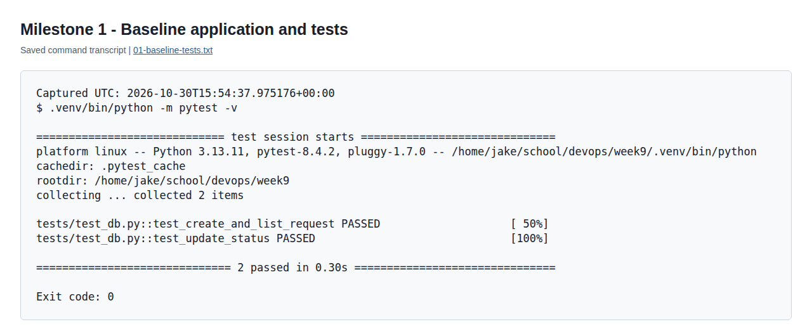

Caption: Both baseline database tests passed before Dockerfile hardening, and the Compose stack ran the web, PostgreSQL, and Adminer services with a healthy database.

[Tests](evidence/commands/01-baseline-tests.txt) | [Compose services](evidence/commands/01-baseline-services.txt) | [Application check](evidence/commands/01-baseline-app.txt)

The starter used the old PostgreSQL volume path with `postgres:18`; the mount was corrected to `/var/lib/postgresql` before baseline startup. The application image still ran as root during this baseline.

## Milestone 2 - .env protected from Git

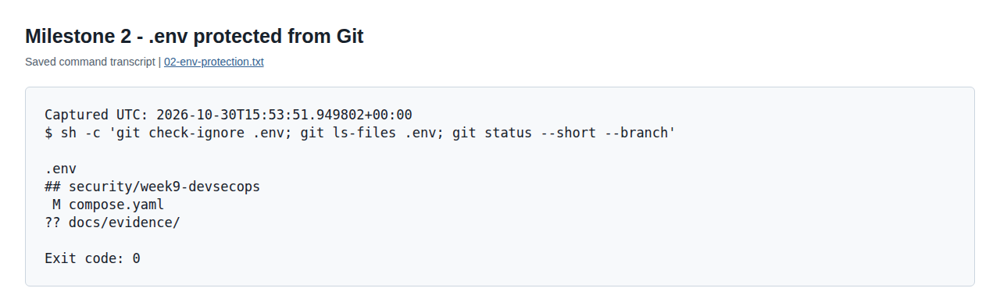

Caption: Git ignores `.env`, and the tracked-file check returns no `.env` entry.

[Command output](evidence/commands/02-env-protection.txt)

The local file contains a generated development password; `.env.example` retains its placeholder, and `.dockerignore` also excludes `.env`.

## Milestone 3 - Dependabot configured

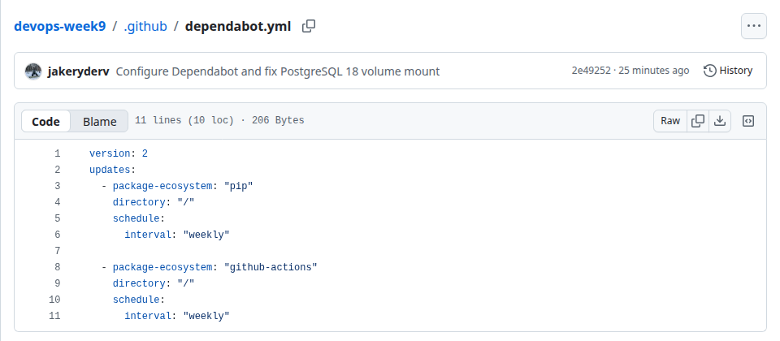

Caption: The configuration on GitHub schedules weekly updates for pip and GitHub Actions at the repository root.

[Configuration on GitHub](https://github.com/jakeryderv/devops-week9/blob/security/week9-devsecops/.github/dependabot.yml)

## Milestone 4 - Baseline Docker Scout CVE scan

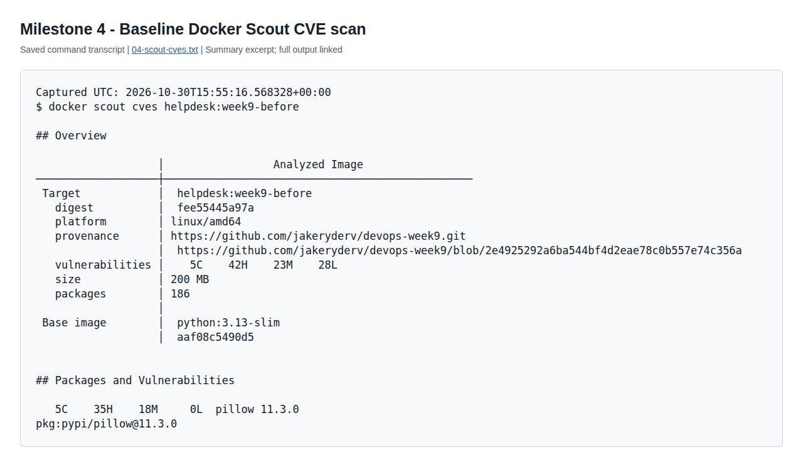

Caption: Docker Scout scanned `helpdesk:week9-before` and reported 98 vulnerabilities: 5 critical, 42 high, 23 medium, and 28 low.

[Complete CVE output](evidence/commands/04-scout-cves.txt) | [Baseline build](evidence/commands/04-baseline-build.txt) | [Baseline UID 0](evidence/commands/04-baseline-uid.txt)

Scout indexed 186 packages and identified 19 vulnerable packages. Pillow 11.3.0 accounted for all five critical findings and 35 high findings; these are scanner findings, not proof that the Help Desk exposes an exploitable path for every CVE.

## Milestone 5 - Docker Scout recommendations / SBOM evidence

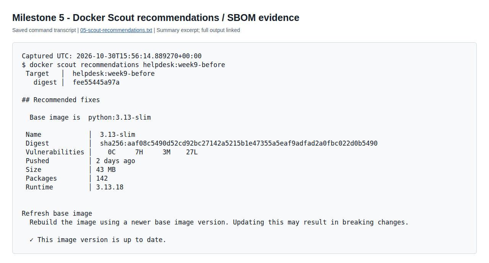

Caption: Scout identified `python:3.13-slim` as the base image and reported that its current image version was up to date despite remaining vulnerability findings.

[Recommendations](evidence/commands/05-scout-recommendations.txt) | [Software inventory](evidence/commands/05-scout-sbom.txt)

The base image had 0 critical, 7 high, 3 medium, and 27 low findings. Scout listed newer Python slim tags with the same base-image counts and an Alpine option with fewer base-image findings; a base-image change would require compatibility testing. The SBOM inventories package names, versions, and ecosystems so Scout can match them to vulnerability records. Functional tests do not perform that inventory or CVE comparison.

## Milestone 6 - Dockerfile hardened to non-root

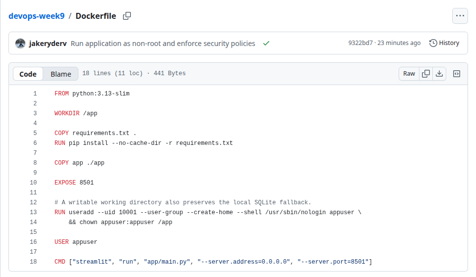

Caption: The Dockerfile creates `appuser` with UID 10001 and switches to it with `USER appuser` before starting Streamlit on port 8501.

[Dockerfile on GitHub](https://github.com/jakeryderv/devops-week9/blob/security/week9-devsecops/Dockerfile)

The user's home directory is created, application files remain readable, and `/app` is writable to preserve the SQLite fallback.

## Milestone 7 - Non-root container verification

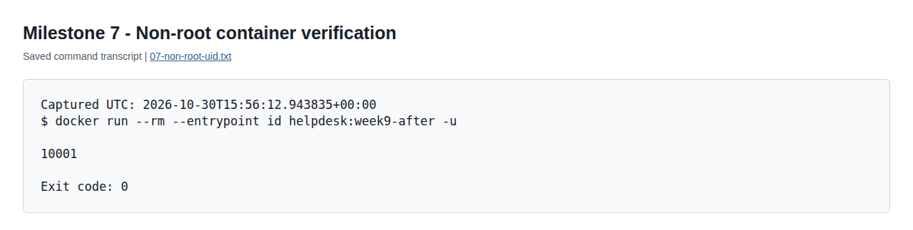

Caption: Running `id -u` in `helpdesk:week9-after` returned 10001, confirming that the hardened image does not run as root.

[Image UID](evidence/commands/07-non-root-uid.txt) | [Running service identity](evidence/commands/07-running-uid.txt) | [PostgreSQL application check](evidence/commands/07-hardened-app.txt) | [SQLite fallback](evidence/commands/07-sqlite-fallback.txt) | [Final tests](evidence/commands/07-final-tests.txt)

## Milestone 8 - Security workflow added

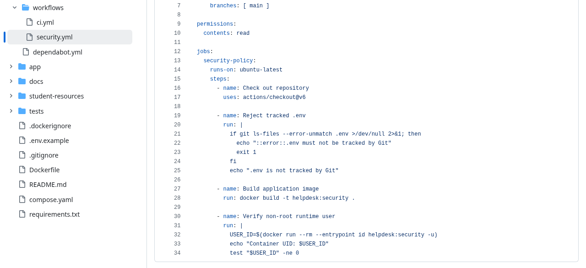

Caption: The GitHub workflow rejects a tracked `.env`, builds the image, and fails when its runtime UID is 0 on pushes and pull requests to `main`.

[Workflow on GitHub](https://github.com/jakeryderv/devops-week9/blob/security/week9-devsecops/.github/workflows/security.yml) | [Positive and negative policy checks](evidence/commands/08-policy-validation.txt)

The exact shell checks accepted the clean repository and UID 10001 image, and rejected a dummy tracked `.env` in a temporary repository and the UID 0 baseline image.

## Milestone 9 - GitHub Actions security checks passing

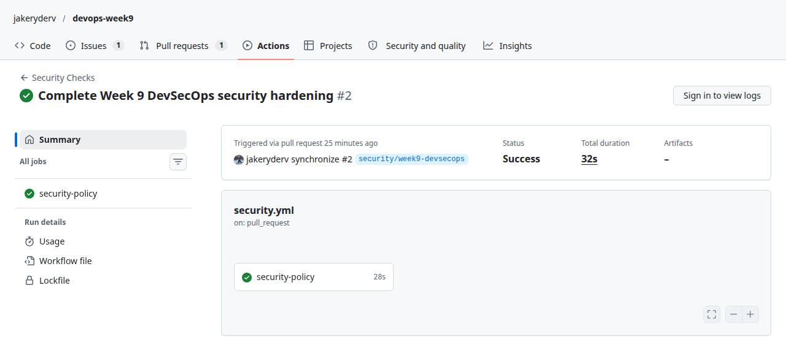

Caption: GitHub Actions shows the security-policy job completed successfully for the security pull request.

[Security Checks run](https://github.com/jakeryderv/devops-week9/actions/runs/41086244268) | [CI run](https://github.com/jakeryderv/devops-week9/actions/runs/41086244276) | [PR check results](evidence/commands/09-pr-checks.txt) | [Security job log](evidence/commands/09-security-workflow.txt)

## Milestone 10 - Final pull request and reflection

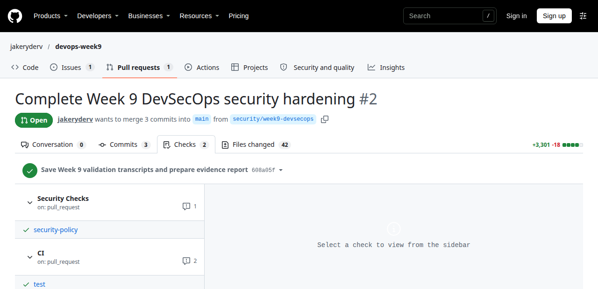

Caption: Pull request #2 contains the Week 9 security changes and successful test and security checks.

[Pull request](https://github.com/jakeryderv/devops-week9/pull/2)

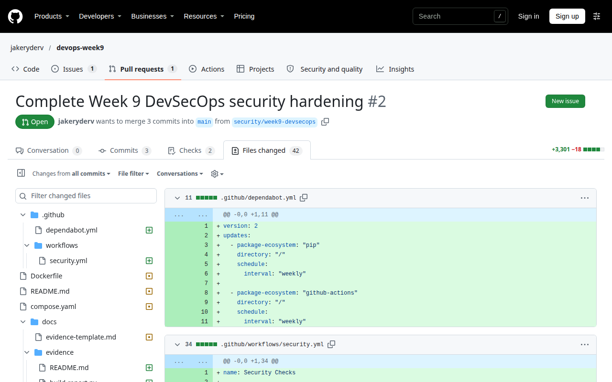

### What security problem does running a container as non-root reduce?

Running as non-root limits the permissions available if the application is compromised. An attacker using the application process cannot automatically modify root-owned files or perform operations that require root inside the container. It reduces the potential damage but does not remove dependency vulnerabilities or guarantee that a container cannot be escaped.

### What did Docker Scout identify that normal functional tests would not identify?

Docker Scout matched installed package versions to known vulnerability records and reported 98 findings in the baseline image, including five critical findings in Pillow. The database tests passed because creating, listing, and updating requests still worked. Those tests do not check the image's operating-system packages or dependency versions against CVE data.

### Why is .env.example appropriate for Git while .env usually is not?

`.env.example` documents the variables needed to configure the application using safe placeholder values. The local `.env` contains the actual development password, so committing it would expose that value in the repository and its history. Keeping the example tracked and the real file ignored makes setup repeatable without sharing the secret.

### How does the security workflow turn a security expectation into an enforceable pipeline policy?

The workflow turns the expectations into commands that return a failure status when `.env` is tracked or the image runs as UID 0. GitHub Actions runs these checks for pull requests and pushes to `main`, so violations produce a failed pipeline check rather than relying only on manual review. The checks were also tested with deliberately failing inputs to verify that they reject both problems.
